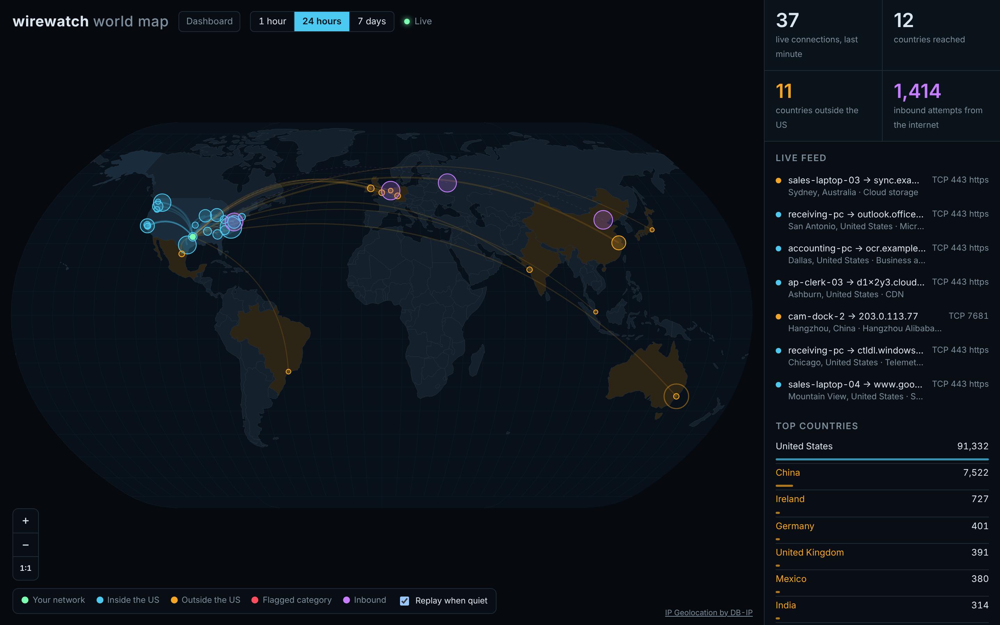
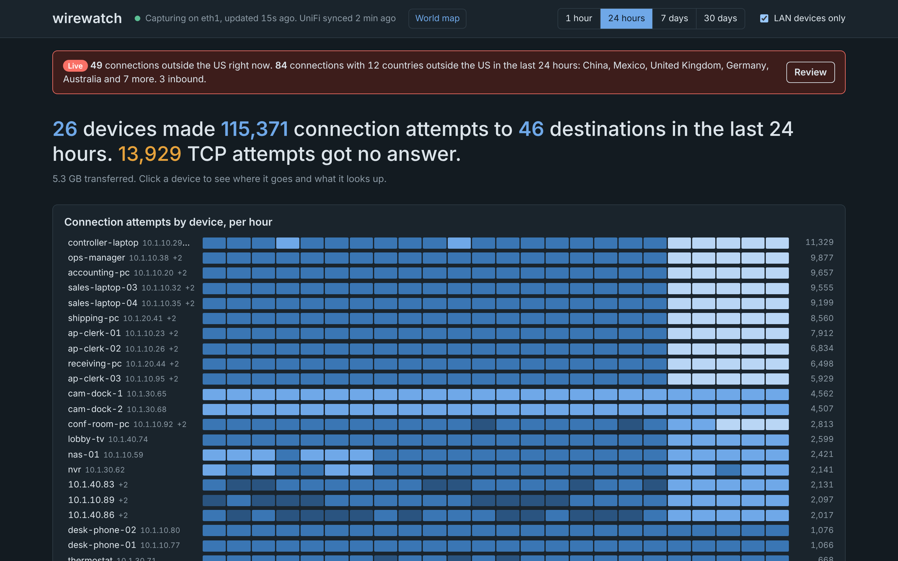

# wirewatch

A small traffic portal for a Raspberry Pi or Ubuntu box. `tshark` watches a network interface, a Python collector turns packets into "device X tried to reach Y on protocol/port Z, this many times", and an HTTPS dashboard shows it.

No pip packages, no database server, no Node. Python 3 standard library, SQLite and tshark.

**[Live demo](https://wirewatch.midstreamintegrations.com/?local=0)**: a small cloud server watching its own traffic, so most of what you'll see is the internet scanning it. On a home or office network, plugged into a mirror port, you see every device instead.

> **Free and MIT-licensed.** Want it running without the setup? [Midstream Integrations](https://www.midstreamintegrations.com/dashboard.html) installs it for you: the mirror port, UniFi, alerts and a wall display. [Book a 20-minute call](https://midstreamintegrations.com/contact).





<sub>Screenshots use made-up sample data.</sub>

## What you get

The dashboard opens with a one-line summary of the time range, then a per-hour heatmap of connection attempts for your busiest devices, then four tables:

- **Devices**: every LAN device that started connections, grouped by MAC address so a device's IPv4 address and all its IPv6 addresses (stable, temporary and link-local) are one row, with MAC, vendor (from Wireshark's OUI list), DHCP hostname when one was seen, attempts, unanswered TCP attempts, how many destinations and ports it used, and its most-used port.
- **Destinations**: every host your devices reached, named from DNS answers, TLS SNI and HTTP Host headers.
- **Protocols and ports**: attempts per protocol/port with the service name, plus how many TCP attempts went unanswered.
- **Connections**: one row per device/destination/port with attempts, answered count, active hours and data volume.

The dashboard remembers your time range and the **LAN devices only** setting in your browser. To share a link that opens with a different view, add `?hours=168` (1, 24, 168 or 720) or `?local=0` (include connections from outside your network), for example `https://<pi>/?local=0`.

Each device also shows its VLAN and, with UniFi connected, the switch and port or the access point and Wi-Fi network it's on. Click any device for its hourly activity, where it connects, what names it looks up in DNS, and who connects to it.

## How "attempts" are counted

| Protocol | One attempt is | "Answered" means |
|---|---|---|
| TCP | a SYN from the client | a SYN-ACK came back |
| UDP | a new conversation, or one that was silent for `WW_UDP_SESSION_GAP` seconds (default 60) | n/a |
| ICMP and others | each packet from the initiator | n/a |

A high count of unanswered TCP attempts usually means a firewall drop, a closed port, a dead server, or something scanning.

## Where to plug it in (this matters)

A switch only sends a port its own traffic plus broadcasts. To see everything you need one of:

1. **A mirror/SPAN port** on your core switch, mirroring the uplink to your firewall (best: catches all internet-bound traffic) or a whole VLAN.
2. **A network tap** between the firewall and the core switch.

Use **two NICs**: one on the mirror port for capture (no IP address) and one normal port for managing the box and serving the dashboard. On a Pi, the onboard Ethernet plus a USB 3 gigabit adapter works. Many switches won't pass normal traffic on a SPAN destination port anyway.

Bring the capture NIC up without an address, for example with netplan on Ubuntu:

```yaml
network:
  version: 2
  ethernets:
    eth1:
      dhcp4: false
      dhcp6: false
      link-local: []
      optional: true
```

Then set `WW_IFACE=eth1` and add the management IP to `WW_IGNORE_IPS` so the box doesn't count its own dashboard traffic.

## Sizing

tshark parses every packet, so CPU is the limit. Rough guide: a Raspberry Pi 4 handles a typical small-office uplink (tens of Mbit/s, a few thousand packets per second) fine; a Pi 5 or any x86 Ubuntu box goes much further. If the collector falls behind (watch `top` or `journalctl -u wirewatch-collector`), narrow `WW_CAPTURE_FILTER`, for example `ip and not port 445` to skip SMB bulk traffic, or move to x86.

Storage is aggregated per hour, so the SQLite file stays small; 30 days of a busy office is typically tens of MB.

## Install

```bash
git clone https://github.com/Midstream-Integrations/wirewatch.git
cd wirewatch
sudo ./install.sh
```

To update later, run `git pull` in the same folder and `sudo ./install.sh` again.

The installer installs tshark, creates a `wirewatch` service user in the `wireshark` group, writes `/etc/wirewatch/wirewatch.env` with a random dashboard password (printed once), creates a self-signed certificate, and starts two systemd services. It's safe to re-run; it won't overwrite your config or certificate.

Then edit `/etc/wirewatch/wirewatch.env` (at least `WW_IFACE` and `WW_LOCAL_NETS`) and run:

```bash
sudo systemctl restart wirewatch-collector wirewatch-web
```

Open `https://<management-ip>/` and log in as `admin`.

To run a public demo with no login, set `WW_PUBLIC=1`. The dashboard and API stay read-only, but anyone who can reach the port sees every device, destination and DNS lookup, so only do this on a box with nothing private on it (for example a cloud server watching its own traffic).

To use a real certificate, point `WW_TLS_CERT` and `WW_TLS_KEY` at it (the files must be readable by the `wirewatch` group). To run on another port, change `WW_PORT`.

## Files

| Path | What |
|---|---|
| `/opt/wirewatch/collector.py` | tshark → aggregates → SQLite |
| `/opt/wirewatch/web.py` | HTTPS server, Basic auth, JSON API |
| `/opt/wirewatch/unifi.py` | UniFi poller for switch port, AP, SSID and VLAN |
| `/opt/wirewatch/intel.py` | Geolocation, network owner and category lookups |
| `/etc/wirewatch/categories.conf` | Your own category rules |
| `/var/lib/wirewatch/intel.db` | Geolocation, ASN and category data |
| `/opt/wirewatch/static/index.html` | the dashboard |
| `/etc/wirewatch/wirewatch.env` | all settings |
| `/var/lib/wirewatch/wirewatch.db` | data |

## VLANs and switch ports

VLAN comes from the best source available, in this order:

1. **UniFi**, which knows each client's network and VLAN.
2. **802.1Q tags** on mirrored frames, if your SPAN session keeps them.
3. **`WW_VLAN_MAP`**, your own subnet-to-VLAN labels.
4. **UniFi network subnets**, for hosts UniFi isn't currently reporting (for example, routed hosts).

The switch and port, or AP and SSID, come from the UniFi Network application's client list. The `wirewatch-unifi` service polls it every 5 minutes (`WW_UNIFI_INTERVAL`). UniFi only reports clients that are connected right now, so wirewatch keeps the last known location for devices that have gone offline and shows when UniFi last saw them.

To connect it:

1. In UniFi, create a local admin with the **View Only** role. Signed in as that admin, create an API key under Settings > Control Plane > Integrations.
2. In `/etc/wirewatch/wirewatch.env`, set `WW_UNIFI_URL` (for example `https://10.1.10.1`) and `WW_UNIFI_API_KEY`.
3. Pin the console's certificate. Print its fingerprint with:
   ```bash
   WW_UNIFI_URL=https://10.1.10.1 python3 /opt/wirewatch/unifi.py --fingerprint
   ```
   Put the output in `WW_UNIFI_CERT_SHA256`.
4. Run `sudo systemctl restart wirewatch-unifi`. The dashboard header shows "UniFi synced …", or the error if it can't connect.

For an old standalone controller (no UniFi OS), set `WW_UNIFI_LEGACY_CONTROLLER=1` and use `WW_UNIFI_USER`/`WW_UNIFI_PASSWORD` instead of an API key.

## Countries, network owners and categories

The `wirewatch-intel` service adds three things to every IP and hostname the collector sees:

- **Location**: country and continent (or state and city with `WW_GEO_DETAIL=city`), from the free DB-IP Lite databases. It downloads them monthly.
- **Network owner**: the organization and AS number that announces the IP (for example "Microsoft Corporation, AS8075"), from DB-IP's ASN Lite database.
- **Category**: website category for every name seen in DNS lookups, TLS SNI or HTTP Host headers. Wirewatch checks your rules in `/etc/wirewatch/categories.conf` first, then a built-in list covering social media, streaming, Microsoft 365, Apple and Google services, CDNs, advertising, telemetry and updates, and then the UT1 lists (around 40 categories, refreshed weekly).

### Outside-the-US alert

Any connection to or from an IP located outside `WW_HOME_COUNTRIES` (default `US`) shows a banner at the top of the dashboard. "Live" means the connection had traffic in the last 10 minutes (`WW_ACTIVE_SECONDS`). The **Outside the US** tab lists each one with the device, direction, remote host, country, network owner, category and port. Inbound attempts (a foreign IP connecting to one of your devices) are marked separately.

Categories in `WW_FLAG_CATEGORIES` (default: malware and phishing, crypto mining, stalkerware) raise their own banner.

### Accuracy

- Geolocation is reliable at the country level for most IPs, but anycast and CDN addresses (Cloudflare, Google DNS, Akamai) are located where the database registers them, not where your traffic was served. For example, 1.1.1.1 shows as Australia. Add trusted services to `WW_FOREIGN_ALLOW`, for example `AS13335` for Cloudflare.
- Categories come from hostnames. Traffic to an IP with no DNS lookup or SNI the collector saw stays uncategorized; the network owner usually tells you enough.
- First run downloads about 100 MB and loads the UT1 adult list, which takes several minutes on a Pi. Run `journalctl -u wirewatch-intel -f` to watch progress.

Attribution: IP geolocation by [DB-IP](https://db-ip.com) (CC BY 4.0). Category lists by Université Toulouse Capitole (UT1, CC BY-SA 4.0). The dashboard footer carries the attribution link DB-IP's license requires.

## World map

`https://<pi>/map` is a full-screen live map of where your traffic goes, in the style of a threat map. It's built for a wall display.

- Every live connection animates from your network to its destination, with the color showing what kind it is: inside your home country, outside it, a flagged category, or inbound from the internet. New traffic arrives every 5 seconds.
- Faint standing arcs and bubbles show every destination in the selected time range, sized by connection attempts. Hover a bubble to see the place, its top hostnames and categories.
- Zoom with the scroll wheel, a trackpad pinch, double-click, the + / − buttons or the + and − keys. Drag to pan. The 1:1 button (or the 0 key) resets the view. Lines and bubbles stay the same size on screen as you zoom, so crowded areas like Europe separate out.
- The side panel shows a live feed, counters and the top countries.
- Click any bubble for every IP address at that location. Each address shows its network owner, every hostname seen for it (from DNS answers, TLS SNI and HTTP Host headers) with its category, the ports used, which of your devices connected and when. Inbound bubbles list the outside addresses that connected to you and which devices they targeted. Full URLs (paths) aren't visible for HTTPS traffic, only hostnames.
- When nothing live has happened for 30 seconds, the map replays recent destinations so a wall display never looks frozen. It says so on screen, and you can turn it off with "Replay when quiet".

Set `WW_MAP_HOME` to your site's coordinates so arcs start at your building. With the default country-level geolocation, every destination in a country lands on the middle of that country. Set `WW_GEO_DETAIL=city` to place destinations at their city, which spreads out domestic traffic (Virginia, Texas and California data centers and so on).

The map's libraries and world outline (d3, topojson-client, world-atlas from Natural Earth) are served from the Pi itself, so the page works on a network without internet access. Their licenses are in `static/vendor/LICENSES.txt`.

## Analyze a saved capture

You can load a pcap you took elsewhere into a separate database and browse it:

```bash
WW_PCAP_FILE=capture.pcapng WW_DB=/tmp/review.db python3 /opt/wirewatch/collector.py
WW_DB=/tmp/review.db WW_PORT=8443 WW_PASSWORD=pick-one python3 /opt/wirewatch/web.py
```

## JSON API

All endpoints take `hours` (default 24) and `local` (1 = only LAN devices as initiators, the default).

- `/api/summary` totals, hourly timeline, heatmap
- `/api/devices`
- `/api/destinations`
- `/api/ports`
- `/api/map` destinations and inbound sources with coordinates, for the world map
- `/api/map/place?cc=&lat=&lon=&direction=outbound|inbound` every IP and hostname at one map location
- `/api/map/events?since=<unix time>` connections active since that time
- `/api/foreign` connections with IPs outside your home countries
- `/api/geo` traffic by country
- `/api/categories` traffic and DNS lookups by category
- `/api/flows` with optional `src`, `dst`, `port`, `proto` (number), `q` (text search), `limit`
- `/api/devices` returns an `id` per device (`mac:…` for grouped devices, otherwise the IP) and its `ips`
- `/api/device?id=…` addresses, hourly timeline, DNS lookups and inbound connections for one device (an IP also works)
- `/api/flows?device=…` limits flows to one device's addresses

## Limits worth knowing

- Encrypted DNS (DoH/DoT) and encrypted ClientHello hide names, so some destinations show as bare IPs.
- Behind a router or VLAN gateway, MAC addresses belong to the gateway, so vendor, DHCP hostname and IPv4/IPv6 grouping only work for hosts on the same L2 segment as the mirror. A MAC seen with 3 or more IPv4 addresses is treated as a router and its hosts stay listed by IP; list router MACs in `WW_GATEWAY_MACS` if auto-detection misses one.
- Devices using a global IPv6 prefix from your ISP only count as LAN devices if that prefix is in `WW_LOCAL_NETS`.
- Phones and newer laptops use randomized MACs; those show as "Private (randomized MAC)".
- Only metadata is stored (addresses, ports, counts, names). No payloads are kept.

## Need help, or something this doesn't do?

[Midstream Integrations](https://www.midstreamintegrations.com) can:

- install wirewatch on a Pi or server for you, set up the mirror port and UniFi, and tune the alerts for your network
- add alerts or reports you need, for example email when a device reaches a new country or a camera talks to the internet
- build custom integrations between your systems, including Microsoft Dynamics 365 Business Central ([our open-source BC apps](https://github.com/Midstream-Integrations))

**[Book a 20-minute call](https://midstreamintegrations.com/contact)** · intro@MidstreamIntegrations.com

## License

wirewatch is released under the [MIT License](LICENSE). Copyright (c) 2026 Midstream Integrations.

It bundles d3, topojson-client and world-atlas (ISC licenses, map data from Natural Earth); see [`static/vendor/LICENSES.txt`](static/vendor/LICENSES.txt). At install time it downloads DB-IP Lite databases ([CC BY 4.0](https://creativecommons.org/licenses/by/4.0/)) and the UT1 category lists from Université Toulouse Capitole ([CC BY-SA 4.0](https://creativecommons.org/licenses/by-sa/4.0/)). Those are not part of this repository and keep their own licenses.

Only use wirewatch on networks you own or are responsible for, and follow your organization's policy on monitoring.
